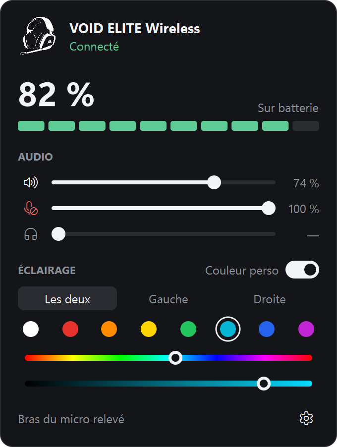
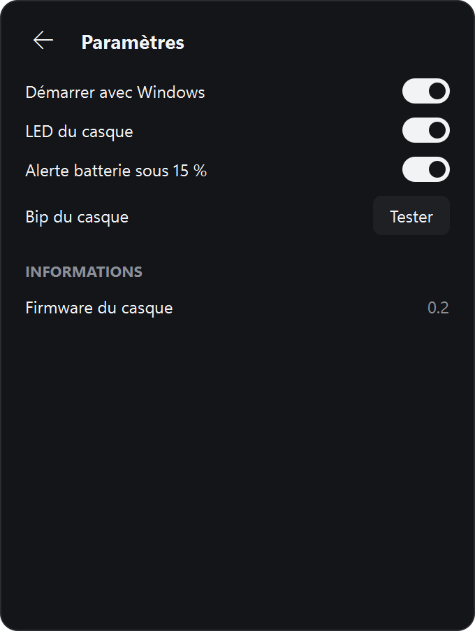

# Corsair Monitor 0.3

Application Windows autonome pour le casque Corsair VOID ELITE Wireless : **elle n'a pas besoin d'iCUE**. Elle reste dans la zone de notification : un clic sur l'icône ouvre le panneau, un clic ailleurs le referme, un clic droit donne les actions rapides.

> Projet personnel non officiel, sans lien avec Corsair ni validation de sa part. Il pilote le casque par des commandes non documentées : à utiliser à vos risques.

## Captures

  
  

Icône de la zone de notification, à plusieurs tailles, avec le point rouge de batterie faible :

## Installation

Testé uniquement sur Windows 11, avec un dongle VOID ELITE Wireless `0x0A51`.

1. Installer Python 3.10 ou plus récent depuis python.org.
2. Brancher le dongle USB et allumer le casque.
3. Cloner ce dépôt, puis lancer `install.bat` et `run.bat`.

Au premier lancement, l'application s'inscrit au démarrage de Windows. Le réglage se désactive dans le panneau, sous Paramètres.

## Fonctions

| Fonction | Passe par |
| --- | --- |
| Batterie, connexion, position du bras de micro | HID direct |
| Couleur des LED, zones gauche et droite | HID direct |
| LED éteintes, effet multicolore d'origine | HID direct |
| Retour micro (sidetone), bip du casque | HID direct |
| Volume et coupure du son | Audio Windows |
| Volume et coupure du micro | Audio Windows |

## Limites

- **iCUE :** s'il est ouvert en même temps, il peut écraser les couleurs. Pour rester autonome, retirer iCUE du démarrage de Windows.
- **Surround et égaliseur :** ils ne sont pas gérés. Ils dépendent d'iCUE et de ses pilotes audio.
- **Retour micro :** le casque ne permet pas de relire le niveau. L'application affiche et réapplique le dernier niveau choisi ici.
- **Batterie en charge :** le pourcentage affiché peut être trop haut (d'environ 54 d'après le pilote Linux). Il redevient exact une fois le casque débranché.
- **Démarrage :** c'est une entrée de démarrage utilisateur (`HKCU\...\Run`), pas un service Windows. Un service tourne dans une session isolée et ne peut ni afficher d'icône ni piloter l'audio de l'utilisateur.

## Protocole d'éclairage

Il n'est pas documenté publiquement. Il a été observé sur les écritures d'iCUE, puis testé sur un VOID ELITE Wireless (dongle `0x0A51`, interface `0xFFC5`).

| Rapport | Effet |
| --- | --- |
| `C8 00 00` | Effet multicolore intégré, qui ignore les couleurs |
| `C8 01 00` | Contrôle logiciel, LED éteintes jusqu'à un changement de couleur |
| `CB <n> (<registre> <valeur>)×n`, 20 octets | Écrit `n` registres de couleur |

Registres dans l'ordre rouge, vert, bleu : gauche `1C 16 17`, droite `1D 18 19`. Les valeurs maximales, qui reprennent la balance d'iCUE, sont `AF` pour le rouge, `97` pour le vert et `78` pour le bleu.

## Fichiers

- `app.py` : icône et panneau.
- `backend.py` : thread qui regroupe tous les accès matériels.
- `corsair_hid.py` : protocole HID du casque.
- `win_audio.py` : volumes via Core Audio.
- `settings.py` : réglages (`%APPDATA%\CorsairMonitor\settings.json`) et démarrage automatique.
- `tools/make_icon.py` : génère `assets/logo.png` depuis l'image source.

Tests : `.venv\Scripts\python.exe tests\test_corsair_hid.py`

## Références

- [Pilote Linux hid-corsair-void.c](https://github.com/torvalds/linux/blob/master/drivers/hid/hid-corsair-void.c)
- [HeadsetControl, corsair_void_rich.hpp](https://github.com/Sapd/HeadsetControl/blob/master/lib/devices/corsair_void_rich.hpp)

## Licence

Le code est sous licence [MIT](LICENSE). Elle ne couvre ni le logo (`assets/logo.png`, visible aussi sur les captures) ni les marques Corsair, iCUE et VOID, qui appartiennent à Corsair.
